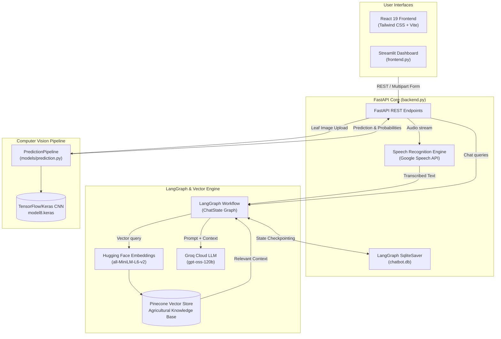

# 🌾 Digital Krishi Officer (കൃഷി സഹായി)
### AI-Based Farmer Query Support, Disease Diagnosis & Advisory System

[](LICENSE)
[](https://www.python.org/)
[](https://fastapi.tiangolo.com/)
[](https://streamlit.io/)
[](https://react.dev/)
[](https://vitejs.dev/)
[](https://langchain-ai.github.io/langgraph/)
[](https://www.pinecone.io/)
[](https://groq.com/)

---

## 📖 Overview

**Digital Krishi Officer (കൃഷി സഹായി)** is a next-generation agricultural advisory platform developed to assist farmers, with specialized knowledge geared towards Kerala's agricultural landscape. The system combines **Retrieval-Augmented Generation (RAG)**, **Multilingual Speech Recognition**, and **Computer Vision** to provide actionable, practical farming intelligence directly into the hands of farmers.

Whether diagnosing plant diseases through leaf image uploads, clarifying crop pest management in regional languages such as Malayalam, or discovering applicable state government schemes, Digital Krishi Officer delivers fast, context-rich, and reliable advisory.

---

## ✨ Key Features

- **💬 Conversational Agricultural Advisory (RAG)**
  - Powered by **LangGraph**, **LangChain**, and high-speed **Groq LLMs** (`openai/gpt-oss-120b`).
  - Contextual responses grounded in verified agricultural handbooks, government schemes, and crop packages of practices.
  - Tailored to Kerala's agro-climatic zones, crop calendars, and Krishi Bhavan extension protocols.

- **🎙️ Multilingual Voice Query Support**
  - Farmers can ask questions via audio or speech in their native languages.
  - Integrated speech-to-text supporting **Malayalam (`ml-IN`)**, **Hindi (`hi-IN`)**, **English**, **Spanish**, **French**, **German**, **Chinese**, and **Arabic**.

- **🌿 Computer Vision Crop Disease Detection**
  - Deep Learning CNN classification pipeline built with **TensorFlow / Keras** (`models/prediction.py`).
  - Upload plant leaf photographs to detect diseases and receive confidence probabilities.
  - One-click transition from disease prediction to chatbot advice for treatment and pest control.

- **📚 Dynamic Knowledge Base & Document Synchronization**
  - Supports indexing of PDF, Word (DOCX), Text, and Markdown documents into a **Pinecone** vector database.
  - Sentence transformer embeddings using `sentence-transformers/all-MiniLM-L6-v2`.
  - Incremental sync engine (`documents_manager.py`, `add_new_documents.py`) to process only new or modified documents without re-indexing from scratch.

- **💾 Stateful Conversation Persistence**
  - Session and thread persistence managed via LangGraph's `SqliteSaver` (`chatbot.db`).
  - Seamlessly resume previous consultations, review conversation history, or start new inquiry threads.

- **🖥️ Dual Frontend Interfaces**
  - **React Single-Page Application (`farmer_support_system/react-frontend`)**: Modern, production-ready frontend built with React 19, Tailwind CSS, Lucide icons, and real-time audio recording.
  - **Streamlit Web Application (`frontend.py`)**: Rapid, interactive Python dashboard featuring audio recording (`st_audiorec`), image upload, and analytics charts.

---

## 🏗️ System Architecture



---

## 📁 Repository Structure

```
.
├── backend.py                  # FastAPI REST API, LangGraph workflow, and endpoints
├── frontend.py                 # Streamlit UI application with voice & vision tabs
├── document_processor.py       # Document chunking, HuggingFace embeddings, Pinecone loader
├── documents_manager.py        # Incremental document sync and status manager
├── add_new_documents.py        # CLI utility to ingest newly added/modified documents
├── init_documents.py           # Knowledge base initialization script
├── delete_index.py             # Utility to inspect and reset Pinecone vector indexes
├── requirements.txt            # Python dependencies
├── chatbot.db                  # SQLite database for LangGraph conversation checkpoints
├── documents/                  # Source agricultural documents (PDFs, statistical handbooks)
│   ├── AGRICULTURAL-STATISTICS-2023.pdf
│   └── pop2016.pdf
├── models/                     # Deep learning inference pipeline
│   └── prediction.py           # TensorFlow/Keras image classification pipeline
├── model/                      # Pre-trained CNN weights & mappings (downloaded locally)
│   ├── model8.keras            # Trained model weights (224x224 input)
│   └── class_indices.json      # Class label mapping
├── farmer_support_system/
│   └── react-frontend/         # Modern React + Vite application
│       ├── package.json        # Node.js dependencies (React 19, Tailwind, Lucide)
│       ├── vite.config.js      # Vite build configuration
│       ├── src/
│       │   ├── components/     # UI primitives (Cards, Buttons, VoiceRecorder, Tabs)
│       │   ├── context/        # ChatContext & DocumentContext state providers
│       │   ├── pages/          # ChatPage, DiseasePredictionPage, DashboardPage
│       │   └── services/       # Axios API client integrations
└── README.md                   # Project documentation
```

---

## 🛠️ Prerequisites & Requirements

- **Python**: 3.10 or 3.11 recommended
- **Node.js**: 18.x or later (for the React frontend)
- **Audio Tools**: Microphone and system audio libraries (e.g., `ffmpeg`, `pyaudio`, `portaudio`)
- **API Accounts**:
  - [Groq API Key](https://console.groq.com/) (for fast LLM inference)
  - [Pinecone API Key](https://www.pinecone.io/) (for vector retrieval)

---

## ⚙️ Environment Configuration

Create a `.env` file in the root directory of the project:

```env
# Groq API Configuration
GROQ_API_KEY=your_groq_api_key_here

# Pinecone Vector Database Configuration
PINECONE_API_KEY=your_pinecone_api_key_here
PINECONE_INDEX_NAME=agricultural-chatbot
PINECONE_REGION=us-east-1

# Embedding Model Configuration
HUGGINGFACE_MODEL=sentence-transformers/all-MiniLM-L6-v2
```

---

## 🚀 Getting Started

### 1. Clone the Repository

```bash
git clone https://github.com/your-username/AI-Based-Farmer-Query-Support-and-Advisory-System-New.git
cd AI-Based-Farmer-Query-Support-and-Advisory-System-New
```

### 2. Set Up Python Environment

```bash
# Create a virtual environment
python -m venv venv

# Activate the virtual environment
# Windows (PowerShell):
.\venv\Scripts\Activate.ps1
# Linux / macOS:
source venv/bin/activate

# Install required Python packages
pip install --upgrade pip
pip install -r requirements.txt
```

> **Note for Windows Users**: If installing `pyaudio` fails via pip, install it using `pipwin install pyaudio` or download the pre-compiled wheel file. Ensure `ffmpeg` is installed and available on your system `PATH`.

### 3. Initialize the Vector Knowledge Base

Place your reference documents (`.pdf`, `.txt`, `.docx`, `.md`) inside the `documents/` folder, then run:

```bash
python init_documents.py
```

To incrementally add new documents without re-indexing existing ones:

```bash
python add_new_documents.py
```

### 4. Download / Place Pre-trained Model Weights

Ensure your disease detection weights and class mappings are placed inside the `model/` folder:
- `model/model8.keras`
- `model/class_indices.json`

### 5. Launch the FastAPI Backend

```bash
python backend.py
```
Or with Uvicorn:
```bash
uvicorn backend:app --reload --host 0.0.0.0 --port 8000
```
The API documentation will be accessible at [http://localhost:8000/docs](http://localhost:8000/docs).

---

## 🖥️ Running the Frontends

You can run either the **Streamlit** dashboard or the **React** application (or both simultaneously).

### Option A: Streamlit Web UI

```bash
streamlit run frontend.py
```
Access the application in your browser at `http://localhost:8501`.

### Option B: Modern React Web Application

```bash
cd farmer_support_system/react-frontend
npm install
npm run dev
```
Access the React frontend in your browser at `http://localhost:5173`.

---

## 📡 API Reference

| Method | Endpoint | Description |
| :--- | :--- | :--- |
| `POST` | `/chat` | Submit messages and conversation history; returns AI advisory response. |
| `POST` | `/voice_query` | Upload audio query file (`.wav`); transcribes speech and returns RAG answer. |
| `GET` | `/threads` | Retrieve all saved conversation thread identifiers. |
| `POST` | `/new_thread` | Generate a unique thread ID for a new conversation. |
| `GET` | `/load_thread/{thread_id}` | Fetch full message history for a given thread. |
| `POST` | `/api/predict-disease/` | Upload a crop leaf image for disease diagnosis and probability scoring. |
| `GET` | `/documents` | List all document filenames present in the knowledge repository. |
| `POST` | `/add_document` | Upload and incrementally vectorize a single new document. |
| `GET` | `/document_status` | Retrieve index and processing status for all stored documents. |
| `POST` | `/sync_documents` | Automatically vectorize pending or modified documents. |
| `GET` | `/processing_status` | Retrieve total document count and indexed vector chunk statistics. |
| `POST` | `/reindex_documents` | Wipe existing vector index and re-index all documents. |

---

## 🌐 Supported Languages

The advisory system natively provides multilingual responses and voice transcription in:

| Language | Speech Recognition Code | Supported in Chat |
| :--- | :---: | :---: |
| **Malayalam (മലയാളം)** | `ml-IN` | ✅ Yes |
| **English** | `en-US` | ✅ Yes |
| **Hindi (हिन्दी)** | `hi-IN` | ✅ Yes |
| **Spanish (Español)** | `es-ES` | ✅ Yes |
| **French (Français)** | `fr-FR` | ✅ Yes |
| **German (Deutsch)** | `de-DE` | ✅ Yes |
| **Chinese (中文)** | `zh-CN` | ✅ Yes |
| **Arabic (العربية)** | `ar-SA` | ✅ Yes |

---

## 🗺️ Future Enhancements

- [ ] **Hyperlocal Weather Integration**: Dynamic weather forecasts and seasonal advisories linked with Indian Meteorological Department (IMD) APIs.
- [ ] **WhatsApp & Telegram Bots**: Conversational bot interfaces for farmers without access to desktop or laptop browsers.
- [ ] **Offline Edge Inference**: Support for offline quantization (e.g., ONNX, Ollama, TensorFlow Lite) on low-resource mobile hardware.
- [ ] **Direct Krishi Bhavan Officer Escalation**: Automated ticket creation for queries requiring certified agronomic inspection.

---

## 📄 License

This project is licensed under the [MIT License](LICENSE) - see the LICENSE file for details.

---

## 👨‍💻 Author & Acknowledgements

- Built with [LangGraph](https://github.com/langchain-ai/langgraph), [FastAPI](https://fastapi.tiangolo.com/), [Groq](https://groq.com/), [Pinecone](https://www.pinecone.io/), [TensorFlow](https://www.tensorflow.org/), [Streamlit](https://streamlit.io/), and [React](https://react.dev/).
- Special thanks to Kerala agricultural resources, package of practices datasets, and open-source agricultural research communities.
